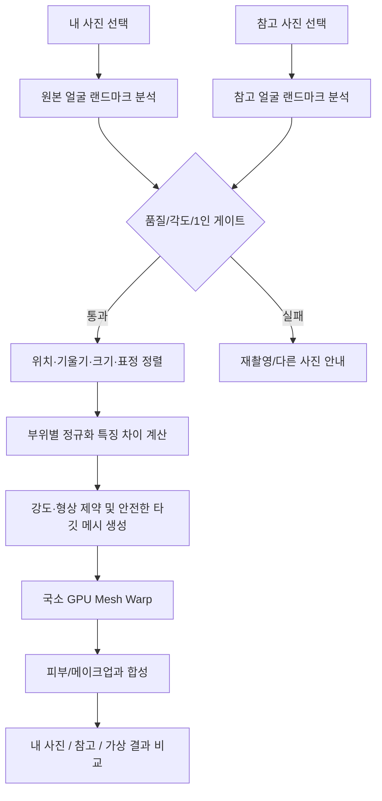

# Reference Match / Consultation Visualization — 엔진 구현 설계 v1.0

상태: **Design Approved for Future Implementation? No — 설계 초안**. 런타임 구현/배포/의료적 검증을 의미하지 않음.
대상: `kdc916/Beauty-Engine`, 현재 런타임 `main.v0.1.5.js`.

## 1. 기능의 경계

### Reference Match (v0.2)
- 입력: `sourceImage` = 사용자 본인 사진, `referenceImage` = 원하는 스타일/인물 참고 사진.
- 출력: 사용자의 사진을 유지하면서 얼굴의 **비식별적 미적 특징**(눈매, 코 비율, 입술 실루엣, 하안면 비율 등)을 강도 범위 내에서 참고한 시각화.
- 목표는 **얼굴 도용·신원 복제·정확한 닮은꼴 보장**이 아니라, 사진을 기준으로 부분적 외형 스타일을 실험하는 것.
- 피부색·인종·나이 등 민감한 속성은 매칭 점수에 포함하지 않음. 피부톤/메이크업 룩 전사는 별도 동의 및 명시적 UI를 통해 처리.

### Consultation Visualization (v0.3)
- 입력: 사용자 사진 + 선택적 참고 이미지 + 얼굴 부위별 보정 슬라이더.
- 출력: 상담용 **가상 외형 시각화**. 실제 치료 계획·해부학적 결과·회복 후 외모 예측이 아님.
- 앱/저장 결과에 항상 고지: `상담용 이미지 시뮬레이션 · 실제 수술 결과를 예측하거나 보장하지 않습니다.`
- 전문가 검증 및 규제 검토 전에는 `AI 수술 결과 예측`, `수술 후 예상 모습`, `정확도 95%` 같은 문구 금지.

## 2. 현재 코드와 도입 지점

| 현 코드 | 상태 | 개선 방향 |
|---|---|---|
| `main.v0.1.5.js` / `state` | 단일 source/face, preset | `source`와 `reference` 입력/FaceAnalysis 분리. 기존 뷰티 프리셋과 새 ReferenceMatchConfig 분리 |
| `startTracking()` / `updateFace()` | MediaPipe 1인, 영상/이미지 모드 | 사진 2장 별도 분석, 모드 전환 직렬화, `sourceGeneration` + `referenceGeneration`으로 비동기 스테일 결과 폐기 |
| `LANDMARK_IDS` (11개) | 간단한 Slim/Eye Warp | 전체 얼굴 메시/부위별 폴리곤 및 규격화된 특징 측정으로 확장 |
| `FACE_OVAL`, 눈/눈썹/입술 마스크 | 피부·메이크업 마스크 | 레퍼런스용 영역 마스크를 재사용하되 버전별 좌표 계약 검증 |
| WebGL2 `FRAG` | 전체 화면 1패스 근사 Warp | 메시 기반 위치 변형(삼각형 + inverse mapping), 별도 GPU 패스, 주변 배경 보호 |
| 고정 프리뷰/컨트롤 패널 | 모바일 동시 보정 UI | 모드: Beauty / Reference / Consultation; 프리뷰는 유지, 하단 입력·비교·부위별 슬라이더만 교체 |
| `capture()` | 미리보기 캔버스 저장 | 상담 모드의 결과 표기/메타데이터/고지를 저장 이미지에 합성. 신원 참조 원본 합성/저장은 선택 동의 |

> MediaPipe 결과의 랜드마크, blendshape, facial transformation matrix는 구성 가능한 옵션입니다. 포즈·표정 정렬에 유용하지만, 단일 이미지에서 수술 후 해부학적 구조를 정확히 복원할 수는 없습니다.

## 3. 처리 파이프라인



### 3.1 분석
1. 이미지 방향(EXIF) 정규화와 색공간 변환. 방향이 다른 이미지는 픽셀 기준 좌표를 동일하게 유지.
2. 얼굴 1개만 인식, 얼굴 검출 실패/2인 이상/눈 가림/심한 포즈 차이에 대해 실패 또는 경고 UI.
3. 얼굴 중심·눈 중앙·코끝·입술·턱 랜드마크 추출 후 interpupillary distance(IPD) 기준 스케일 정규화.
4. 회전 정렬: roll과 translation은 2D similarity transform, yaw/pitch는 모델의 3D/포즈 추정 데이터가 있을 때 품질 게이트로 사용.
5. 표정/눈 감김/입 벌림에 의한 차이와 형태(비율) 차이를 분리. 표정 차이를 성형 특징 차이로 오인하지 않도록 제한.

### 3.2 얼굴 특징값
- eyes: 좌우 눈의 폭/높이 비, 눈꼬리 기울기, 좌우 간격 등.
- nose: 코 날개 폭 / 눈 간격 비, 코끝/콧방울 랜드마크 비율. **단일 정면 사진으로 코 높이·실제 돌출량 판단 금지**.
- lips: 윗입술/아랫입술 높이, 가로 폭, 입꼬리 상대 위치; 표정 차이 무시.
- jaw: 볼 폭·턱 폭·턱끝 위치·하관 길이/얼굴 높이 비.
- brow: 눈썹 높이/기울기, 눈과의 거리. 독립 모듈.
- measurements는 **정규화된 무차원 기하값**이며, 신원 추정용 임베딩이나 의료 진단치가 아님.

### 3.3 변화량 생성
- `delta_region = clamp(reference_region - source_region, per_region_limit)`.
- `target = source + strength_global * strength_region * delta_region`.
- 기본 강도는 0.35(35%), 사용자에 따라 변경 가능하되 형태 변화량에 **별도의 안전한 상한** 적용.
- 좌우 균형을 무조건 강제하지 않으며, 기존 사용자 비대칭 특징을 최대한 유지.
- 눈·코·입·턱 부위별 가중치 독립. 모든 슬라이더 0이면 원본 픽셀과 동일하게 처리(변색 효과 별도 OFF).

### 3.4 GPU 워프
- 기존 11 uniform 중심 국소 Warp를 그대로 확장하지 않는다.
- MediaPipe 얼굴 정점의 2D 삼각 분할과 UV 좌표를 별도 메시 버퍼 또는 displacement texture로 관리한다.
- 원본 얼굴 외곽 바깥의 displacement는 0. 경계 8~16px(해상도 비례) feathering 및 fold-over 삼각형 검사.
- 코·입·눈 주변은 로컬 보호 영역 및 복수 마스크 사용, 신원 분별 핵심 특징의 과도한 전사 금지.
- WebGL2 모바일의 텍스처/float precision 폴백 및 저장 프레임에서 배경/얼굴 합성 정합성 검사.

## 4. 인터페이스 및 데이터 모델

```ts
// 런타임 상태: 사용자 얼굴 이미지와 참고 사진은 휘발성 메모리.
type FaceInput = {
  kind: 'source' | 'reference';
  bitmap: ImageBitmap | HTMLImageElement;
  sourceGeneration: number;
};

type FaceAnalysis = {
  imageWidth: number;
  imageHeight: number;
  landmarks: Float32Array; // xyz interleaved, frame normalized
  faceCount: number;
  pose: { yawDeg?: number; pitchDeg?: number; rollDeg: number };
  featureRatios: Record<'eyes'|'nose'|'lips'|'jaw'|'brow', number[]>;
  confidence: number | null;
  warnings: string[];
};

type ReferenceMatchConfig = {
  schemaVersion: 'maxvfx.reference-match.v1';
  mode: 'reference';
  enabled: boolean;
  globalStrength: number; // 0..1
  regions: { eyes: number; nose: number; lips: number; jaw: number; brow: number };
  maxDisplacementIPD: number; // 0..0.1, hard safety cap
  includeMakeupLook: boolean;
  includeColorLook: boolean;
};
```

영구 저장/내보내기는 `schemas/reference-match-config.schema.json`만 검증하는 **효과 설정값**으로 제한한다. 이미지 원본, FaceAnalysis 랜드마크, 얼굴 임베딩, 참고 인물의 신원/파일 경로를 프리셋에 포함하지 않는다.

### 사진 교체·종료 처리
- 입력 소스 교체 시 추적 결과의 세대 번호를 올려 이전 Promise 반환값을 무시.
- UI에서 사진 삭제/페이지 종료 시 URL revoke, ImageBitmap.close() 가능하면 호출, GPU texture 해제.
- 추후 클리닉/상담 기록 기능은 별도 명시적 동의, 보관 기간·암호화·삭제 API/정책 검토가 필요.

## 5. 모바일/PC UX 설계

### 모바일
1. 현재처럼 **고정 프리뷰** 유지(사진 확대/원본 비교 포함).
2. 상단 모드 스위치: **Beauty / Reference / Consultation(추후)**.
3. Reference 모드에서 `내 사진`과 `참고 사진` 썸네일을 한 줄에 배치, 각각 변경/삭제 버튼 제공.
4. `매칭 강도` 전체 슬라이더 0~100, 아래 `눈 / 코 / 입술 / 턱 / 눈썹` 개별 탭.
5. 비교: [내 원본 | 참고 사진 | 가상 보정] 세 상태를 스와이프/탭으로 전환. 실제 프리뷰를 가리지 않도록 하단 시트에 조작 배치.
6. 추적 실패/각도 불일치/얼굴 2인 이상일 때는 결과를 만들지 않고 안내 표시.

### PC
- 좌측 또는 중앙 프리뷰를 넓게 사용하며, 우측 레퍼런스 썸네일/영역 설정.
- 3면 비교: source/reference/simulation, 최적화 후 링크된 확대/동기화.

### 고지 표시
- Reference 모드: `참고 사진의 일부 외형 특징을 적용한 가상 이미지입니다.`
- Consultation 모드: `상담용 이미지 시뮬레이션 · 실제 수술 결과를 예측하거나 보장하지 않습니다.`
- Consultation PNG/리포트 저장본에도 같은 고지 포함(기본 제거 불가).

## 6. 품질 게이트·오류 처리
- 얼굴 0개/2개 이상, 크기 너무 작음, 사진 손상, 지원하지 않는 포맷: 명시적 오류와 재입력 경로.
- 정면 사진 권장. yaw/roll 15~20° 이상부터 품질 경고(초기 튜닝용 임계값, 임상 기준 아님).
- 0% matching = 소스 원본(색감/뷰티 필터도 비활성 조건 확인).
- 전체 strength 100%에서도 국소 displacement 상한 유지, 얇은 메시 뒤집힘/그물 찢김 방지.
- 얼굴 바깥은 source와 차이 ≤1 LSB/채널(렌더러 색공간 영향에 따라 보정).
- 피부/메이크업 룩 혼합은 기하 Warp와 별도 선택 기능, 미적 참고와 신원 동화 구분.
- QA 문서: `docs/QA_REFERENCE_MATCH.md`.

## 7. 구현 태스크 분할

| 태스크 | 개발 파일(안) | 선행 조건 | 완료 조건 |
|---|---|---|---|
| REF-001 이미지 2소스 입력 | `src/reference/reference-input.js` | 현재 파일 업로드 | 권한/종횡비/EXIF/세대 번호 검증 |
| REF-002 Face Analysis | `src/reference/face-analysis.js` | MediaPipe | 사진 2장 랜드마크 / 포즈 경고 |
| REF-003 Feature Normalization | `src/reference/feature-metrics.js` | REF-002 | 회전/크기/표정 강건성 |
| REF-004 Constraints | `src/reference/warp-limits.js` | REF-003 | 한도/원본성/배경 보호 |
| REF-005 Mesh Warp | `src/reference/mesh-warp.js`, `shaders/reference-warp.frag` | REF-004 | 0% 항등, 경계/삼각형 fold-over 테스트 |
| REF-006 Match UI | `src/reference/reference-ui.js` | REF-001~005 | 모바일 고정 프리뷰·3면 비교 |
| REF-007 Export / Privacy | `src/reference/reference-export.js` | REF-006 | 고지/사진 취소/삭제/프리셋 schema |
| CONSULT-001 2D 시각화 | `src/consultation/` | v0.2 QA 완료 | 유형별 보수적 시각화·항상 고지 |
| CONSULT-002 3D feasibility | 별도 R&D 모듈 | CONSULT-001 | 부정확도 문서화, 출시 전 별도 승인 |

**버전 게이트:** REF-001~007이 착수되어도 실제 기능이 없는 버전에서는 UI를 출시하지 않는다. `v0.1.5` 기능 유지, v0.2 마일스톤 도달 때 활성화.

## 8. 설계에서 제외하는 주장
- '참고 연예인과 95% 동일', '수술 후 결과 예측 정확도', '시술 성공 보장' 표기 금지.
- 시뮬레이션은 실제 뼈/연골/피하지방/피부 탄성/부종/치유 변화를 아는 모델이 아니다.
- 향후 전문 클리닉용 제품으로 사용하기 전 해당 국가의 의료기기 관련 규정, 개인정보·생체정보 취급, 연구 윤리, 임상 검증 여부를 전문가와 별도 검토한다.

## 기술 참조
- MediaPipe Face Landmarker API: https://ai.google.dev/edge/api/mediapipe/python/mp/tasks/vision/FaceLandmarkerOptions
- ASPS, AI-enhanced face vs clinical simulation: https://www.plasticsurgery.org/news/articles/the-ai-face-when-inspiration-photos-arent-real
- Preoperative simulation literature review: https://pmc.ncbi.nlm.nih.gov/articles/PMC13441132/
